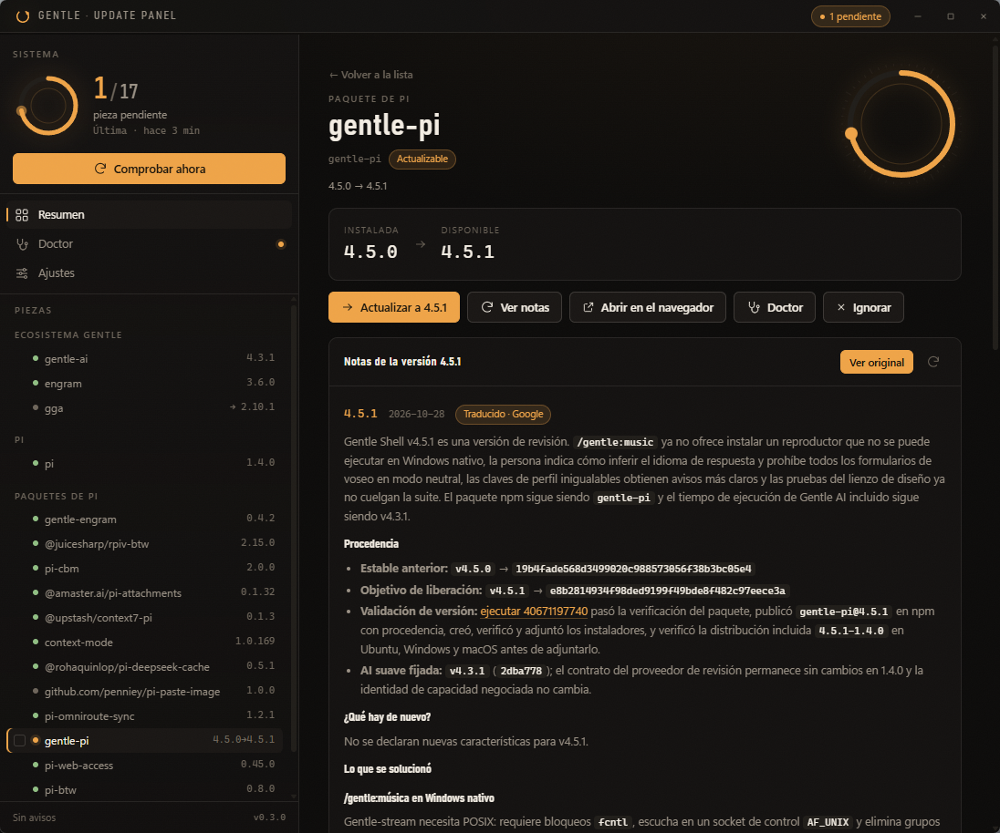

# Gentle Update Panel

Windows desktop panel that watches for updates across the Gentle AI ecosystem and pi, shows what each version brings and applies only what you choose. It lives in the system tray and checks in the background every `N` minutes.

```
gentle-ai · engram · gga        <- gentle-ai update
pi                              <- pi --version + npm
pi packages (npm and git)       <- pi list + package.json + npm registry
```

<p align="center">
  
</p>

<p align="center"><em>Translated release notes, version navigation and per-piece actions.</em></p>

## What it does

- **Speaks the language you pick**: the interface, the tray, the notifications and the new Registry entries come in Spanish, English, Portuguese, French, Italian or German. Settings has a language control; left on *Same as Windows* it follows the system language, and a language the panel was never translated into falls back to English. The dictionaries live in `src/i18n/` and key parity is enforced by the compiler: every dictionary is typed against the Spanish keys, so an incomplete translation does not compile.

- **Checks** the ecosystem (`gentle-ai update`), the `pi` version and every package declared in `pi list`.
- **Shows what is new**: one version at a time, with `←` `→` arrows to walk the history (up to 8 releases), clickable links that open the browser (GitHub autolinks to `#123` and to commits included) and its own context menu on every link.
- **Searches the notes**: a search box walks every release already downloaded, from any piece, and jumps to the matching version.
- **Checks what is running before updating**: it detects pi, engram, gentle-ai, gga and the CodeGraph daemon without spawning PowerShell. If something interferes it opens a dialog with the processes, marks the blocked steps in red (and leaves them unselected) and lets you cancel. `pi` blocks its own updates and those of its packages; `engram` only warns, because `gentle-ai` closes it with `Stop-Process -Force` before replacing it.
- **Updates by selection**: `gentle-ai upgrade <tool>`, `pi update --self` or `pi update --extension <source>`, with the output live in an activity drawer.
- **Keeps a record of everything**: every check, every detection (with installed and available version), the batch launched, each piece's command, its console output, the outcome (applied or failed) and the doctor that follows. It lives in **Journal**, is stored in `journal.ndjson` (append format, last 800 events), survives restarts and can be filtered by kind or text, copied to the clipboard or cleared with confirmation.
- **Translates the notes**: with two free keyless endpoints (Google `translate_a/single` and Microsoft `translate_edge/translatetext`). It protects code, paths and links with placeholders before sending, caches per version and falls back to the second engine when the first fails. *Translate* / *Show original* switch and a "translated automatically" badge.
- **Ignores pieces**: from Settings you can silence gentle-ai, engram, gga, pi or any package. They stay listed (so it can be undone) but no longer count as pending, do not notify, are not updated and their published version is not even queried.
- **Serialises the work**: a check and an update never run at the same time (`work_lock`), and the scheduler waits while an apply is in progress.
- **Verifies**: it runs `gentle-ai doctor` after applying (configurable) and shows checks, remedies and the full output.
- **Silences doctor checks**: from Settings → *Doctor rules* you can ignore specific checks by id (`tool:hermes` for good) and enable the automatic silence of `tool:*` when that tool is not installed (a disabled `gga`, for instance). Silenced checks do not count towards the status but stay readable in a dropdown.
- **Verifies the pi install**: since pi has no `doctor`, the panel checks on its own that every package exists on disk, that its `package.json` parses, that it declares a version and that the resources it announces (`pi.extensions`, `pi.skills`, `pi.themes`, `pi.prompts`) exist. It also validates `settings.json` (duplicates) and the npm extension tree.
- **Lives in the tray**: badge with pending items, toast notification, menu (Open, Check now, Doctor, Update panel, Quit) and start with Windows (HKCU, no admin).
- **Updates itself**: every check also looks at the latest release of this repository. When a newer version exists the panel says so in the tray (*Update panel to X*), in Overview and with a notice; clicking it downloads the installer, quits, installs it silently and opens again on its own. It does not verify a signature: it runs the installer published by this repository's release.
