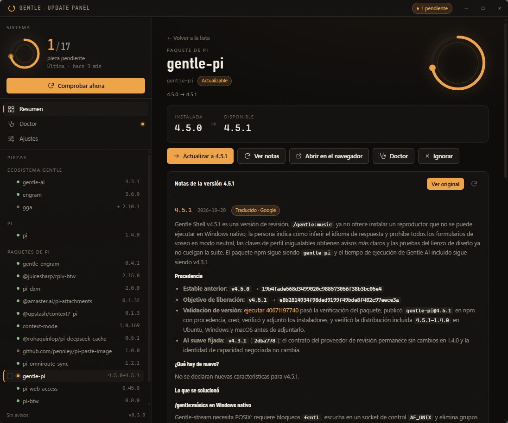

# Gentle Update Panel

Panel de escritorio para Windows que vigila las actualizaciones del ecosistema Gentle AI y de pi, muestra qué trae cada versión y aplica solo lo que tú elijas. Vive en la bandeja del sistema y comprueba en segundo plano cada `N` minutos.

```
gentle-ai · engram · gga        <- gentle-ai update
pi                              <- pi --version + npm
paquetes de pi (npm y git)      <- pi list + package.json + npm registry
```

<p align="center">
  
</p>

<p align="center"><em>Notas de versión traducidas, navegación entre versiones y acciones por pieza.</em></p>

## Qué hace

- **Comprueba** el ecosistema (`gentle-ai update`), la versión de `pi` y cada paquete declarado en `pi list`.
- **Muestra el "qué trae de nuevo"**: una versión a la vez, con flechas `←` `→` para recorrer el historial (hasta 8 releases), enlaces clicables que abren el navegador (incluidos los autoenlaces de GitHub a `#123` y a commits) y menú contextual propio sobre cada enlace.
- **Busca en las notas**: un cuadro de búsqueda recorre todas las releases ya descargadas, de cualquier pieza, y salta a la versión concreta.
- **Comprueba qué hay corriendo antes de actualizar**: detecta pi, engram, gentle-ai, gga y el daemon de CodeGraph sin lanzar PowerShell. Si algo interfiere, abre un diálogo con los procesos, marca en rojo los pasos bloqueados (y no los preselecciona) y deja cancelar. `pi` bloquea sus propias actualizaciones y las de sus paquetes; `engram` solo avisa, porque `gentle-ai` lo cierra con `Stop-Process -Force` antes de reemplazarlo.
- **Actualiza por selección**: `gentle-ai upgrade <tool>`, `pi update --self` o `pi update --extension <source>`, con la salida en vivo en un cajón de actividad.
- **Deja un registro de todo**: cada comprobación, cada detección (con versión instalada y disponible), el lote lanzado, el comando de cada pieza, su salida de consola, el resultado (aplicada o fallida) y el doctor posterior. Vive en **Registro**, se guarda en `journal.ndjson` (formato append, últimos 800 eventos), sobrevive al reinicio y se puede filtrar por tipo o texto, copiar al portapapeles o vaciar con confirmación.
- **Traduce las notas**: con dos endpoints gratuitos y sin clave (Google `translate_a/single` y Microsoft `translate_edge/translatetext`). Protege código, rutas y enlaces con marcadores antes de enviar, cachea por versión y cae al segundo motor si el primero falla. Conmutador *Traducir / Ver original* y aviso de "traducido automáticamente".
- **Ignora piezas**: en Ajustes puedes silenciar gentle-ai, engram, gga, pi o cualquier paquete. Siguen listadas (para poder revertirlo), pero no cuentan como pendientes, no avisan, no se actualizan y ni siquiera se consulta su versión publicada.
- **Serializa el trabajo**: una comprobación y una actualización nunca corren a la vez (`work_lock`), y el scheduler espera si hay un apply en curso.
- **Verifica**: ejecuta `gentle-ai doctor` después de aplicar (configurable) y muestra checks, remedios y salida completa.
- **Silencia checks del doctor**: en Ajustes → *Reglas del doctor* puedes ignorar comprobaciones concretas por id (`tool:hermes` para siempre) y activar el silencio automático de `tool:*` cuando esa herramienta no está instalada (por ejemplo `gga` deshabilitado). Las silenciadas no cuentan para el estado, pero siguen consultables en un desplegable.
- **Verifica la instalación de pi**: como pi no tiene `doctor`, el panel comprueba por su cuenta que cada paquete existe en disco, que su `package.json` se lee, que declara versión y que los recursos que anuncia (`pi.extensions`, `pi.skills`, `pi.themes`, `pi.prompts`) existen. Además valida `settings.json` (duplicados) y el árbol npm de extensiones.
- **Vive en la bandeja**: badge con pendientes, notificación toast, menú (Abrir, Comprobar ahora, Doctor, Salir) y arranque con Windows (HKCU, sin admin).

## Uso

```bash
npm install
npm run tauri dev      # desarrollo con HMR
npm run tauri build    # instalador NSIS en src-tauri/target/release/bundle/nsis/
```

- **Cerrar** (X) oculta la ventana; se sale desde el menú de la bandeja.
- **Secciones**: Resumen (qué hay y qué se puede actualizar), Doctor (salud del ecosistema y de pi), Registro (qué pasó y cuándo) y Ajustes.
- **Ajustes**: frecuencia (15 min → 24 h, o Manual), automatismo (Avisar / Confirmar / Automático), notificaciones, doctor automático, arranque minimizado, arranque con Windows y la lista de **piezas ignoradas**.
- **Arranque con Windows** usa la clave `HKCU\Software\Microsoft\Windows\CurrentVersion\Run` con el argumento `--minimized`.

## Arquitectura

```
src/                 UI (TypeScript + Vite, sin frameworks)
  store.ts           estado + acciones, eventos de Tauri
  ui/format.ts       escaping, markdown seguro, iconos, gauge SVG
  ui/views.ts        rail, resumen, detalle, doctor, registro, ajustes
  ui/shell.ts        titlebar, delegación de eventos, drawer, toasts
src-tauri/src/
  parsers.rs         parsers puros de salidas CLI + tests
  cli.rs             ejecución de CLIs (shims .cmd, timeouts, streaming)
  probe.rs           sondas: gentle-ai, pi, paquetes, registro npm
  notes.rs           notas de versión con caché y reintento
  doctor.rs          gentle-ai doctor
  upgrade.rs         plan y aplicación de actualizaciones
  journal.rs         registro durable en NDJSON: append, rotación y migración
  cache.rs           límites compartidos de las cachés (edad, número y bytes)
  service.rs         ciclo de comprobación + detecciones + notificaciones
  tray.rs            bandeja y visibilidad de la ventana
  scheduler.rs       comprobación periódica
  state.rs           config, snapshot y doctor persistidos
```

## Datos

Todo se guarda en `%APPDATA%\dev.gentle.update-panel\`:

| Fichero | Contenido |
|---|---|
| `config.json` | frecuencia, automatismo, vista y pieza recordadas, lista de ignoradas |
| `snapshot.json` | última comprobación (se muestra al instante al abrir) |
| `doctor.json` | último informe del doctor |
| `journal.ndjson` | registro append-only de comprobaciones, detecciones y actualizaciones (últimos 800 eventos; se compacta solo) |
| `pi-health.json` | última verificación de instalación de pi y sus paquetes |
| `notes-cache.json` | notas de versión (TTL 6 h; máx. 150 entradas, 3 MB y 45 días) |
| `translations.json` | traducciones por versión, motor e idioma (máx. 300 entradas, 3 MB y 90 días) |

## Releases

Cada push a `main` pasa por `.github/workflows/release.yml`:

1. Lee la versión de `src-tauri/Cargo.toml` y exige que coincida con `package.json` y `src-tauri/tauri.conf.json`.
2. Si el tag `vX.Y.Z` ya existe, termina sin hacer nada.
3. Si es nuevo, compila el instalador NSIS en `windows-latest`, publica la release con las notas que genera GitHub (`--generate-notes`, acotadas a la release anterior) y adjunta el `.exe`.

Para publicar una versión basta con subir el número en los tres ficheros y hacer push:

```bash
npm version 0.4.0 --no-git-tag-version
sed -i 's/^version = "0.3.0"/version = "0.4.0"/' src-tauri/Cargo.toml
python -c "import json,io; p='src-tauri/tauri.conf.json'; d=json.load(open(p)); d['version']='0.4.0'; json.dump(d, open(p,'w'), indent=2)"
```

Si los tres números no coinciden, el workflow falla en el primer job antes de compilar nada.

## Desarrollo

```bash
cd src-tauri && cargo test          # 22 tests de parsers, contadores y planificación
cargo test --lib -- --ignored       # comprobaciones en vivo contra tus CLIs
```

`tools/` contiene utilidades usadas para generar iconos y capturar la ventana en pruebas visuales.
